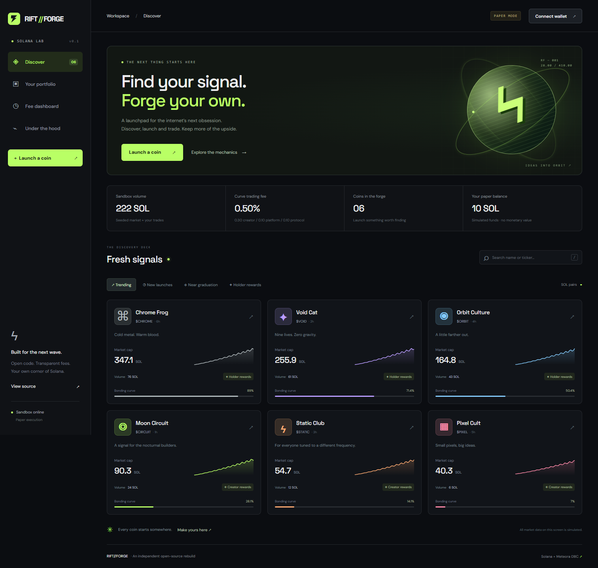

# RIFT//FORGE

**Launch something different.** An original Solana launchpad workbench reconstructed from Mogz's public interface, documentation and decoded on-chain configuration.



## Run it

Requires Node.js **24.2+** (built-in SQLite) and pnpm 11+.

```sh
pnpm install
pnpm dev
```

Open http://127.0.0.1:5173. The local API runs on port 8787. The default account has **10 paper SOL**; six fictional markets demonstrate the mechanics.

```sh
pnpm test          # domain, persistence and SDK reconstruction checks
pnpm build         # strict TypeScript check + production client build
pnpm start         # serve the production build + API on port 8787
pnpm scan          # live, read-only scan of the MOGZ mint and DBC pool/config
pnpm scan <mint>   # scan another SPL mint
```

To run the isolated browser checks after a production build:

```sh
pnpm exec playwright install chromium
pnpm test:browser
```

They start their own server and temporary SQLite account, then exercise buy/sell, portfolio, launch, fee dashboard, research, search and mobile layout. Screenshots are saved under `test-results/`. Set `CHROME_PATH` to test against an installed Chromium browser instead.

Set `SOLANA_RPC_URL` to use a different RPC provider or cluster. Read-only scanning defaults to mainnet. Unsigned transaction builders verify the genesis hash and only accept **devnet**. No private key is requested or stored.

## What works

| Area        | Implementation                                                                                |
| ----------- | --------------------------------------------------------------------------------------------- |
| Discovery   | Search, volume/new/graduating sorting, holder-rewards filter, responsive coin cards           |
| Creation    | Validated paper launches with name, ticker, description and reward designation                |
| Trading     | Paper buys/sells, exact integer amounts, quote previews, slippage limits, version checks      |
| Persistence | SQLite transaction wrapping, balances, holdings, per-coin state and recent trade history      |
| Fees        | 50 bps standard, 99% in the simulated launch slot; quote-token fee ledger split 60/20/20      |
| Portfolio   | Paper positions, balances and execution history; explicit reset                               |
| Research    | Live read-only mint/pool/config inspector, evidence snapshot and reconstruction tests         |
| Wallet      | Injected Solana wallet connection for identity; browser paper trades never request signatures |
| Meteora     | SDK 2.0.0 curve/config builder and devnet-only unsigned config, launch and swap builders      |

## What the chain told us

Target: `Pmfm2RprxQRKZH1XWVsBUc2KgCTyzeDTSFbT1vJmogz`

The read at **2026-10-28 14:53:56 UTC** found a classic SPL mint with six decimals and revoked mint/freeze authorities. Its DBC pool was already migrated. The decoded partner config uses a one-slot linear fee schedule (99% → 0.5%), a 75% creator share of fees remaining after the protocol share, and 50%/50% permanently locked creator/partner liquidity.

The reconstructed SDK policy reproduces the snapshot's integer curve segments, starting sqrt price and migration quote threshold. New fee-recipient addresses must be supplied by the operator; the original project's fee wallets are not reused.

See [the investigation](docs/RESEARCH.md), [chain snapshot](docs/mogz-chain-snapshot.json) and [architecture / next steps](docs/ARCHITECTURE.md).

## Execution boundaries

The browser is a **local paper market**, with fictional seeded data. Its virtual constant-product approximation is intentionally separate from Meteora's exact quote math. Seeded history represents illustrative activity. Portfolio and fee totals include seeded trades, and have no monetary value.

The API stores one paper account per installation and binds to loopback by default. It is intended for local use. Authentication, per-user accounts, deployment hardening and operational services are required before exposing it publicly.

`server/meteora.ts` builds unsigned devnet transactions. It has no signing or broadcasting methods and is not wired to the paper UI. SDK configuration reconstruction is tested against the mainnet evidence snapshot; launching, swapping and migration have **not** been exercised on devnet in this build.

Holder rewards currently accrue as a designation in the fee ledger. There is no payout worker. DAMM v2 execution, USDC/custom pairs, holder snapshots, charity splits, media storage, bounties, social feeds and automated buybacks remain documented integration work. This is a working local reconstruction of the launchpad core, not a production-equivalent copy of every Mogz service.

## Layout

```text
src/                  React UI, styles and integer paper engine
server/index.ts       HTTP API and production static server
server/store.ts       SQLite atomic persistence
server/inspect.ts     read-only Solana + DBC inspection
server/meteora.ts     reconstructed policy / unsigned devnet builders
scripts/scan.ts       standalone mint scanner
tests/                domain, persistence and reconstruction verification
docs/                 research, architecture and public evidence
```

Original source code: MIT. Third-party dependencies retain their own licenses. No Mogz source code, artwork, credentials or private services are included. Meteora's SDK and on-chain programs have separate licensing; using the existing protocol does not require copying or redeploying its programs.
