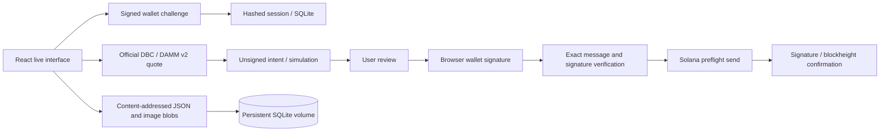

# Live architecture

`server/runtime.ts` validates settings and pins clusters to their full genesis hashes. `server/live-chain.ts` handles live reads, quotes, canonical migration routing, construction, simulation, intent storage, relay and confirmation. `server/live-http.ts` supplies authenticated routes, upload validation and request/concurrency limits. `server/live-store.ts` persists nonces, hashed sessions, immutable assets, catalog metadata, prepared intents and audit events.

`src/live/LiveApp.tsx` implements wallet connection/sign-in, setup, creation, trading, portfolio, fee claims, review and confirmation. New config/mint account keypairs stay in the browser. The client checks the message hash and fee payer before signing. Every transaction requires a review action followed by wallet approval.

## Policy and execution

A partner config is provided through `DBC_CONFIG_ADDRESS` or registered after wallet-signed setup. The on-chain fee claimer and leftover receiver must equal `PLATFORM_FEE_WALLET`. Validation checks SOL/classic SPL, supply/decimals, curve geometry, launch schedule, migration, fee allocation, LP locks and graduated fee schedule. The older standalone `MeteoraBuilder` remains devnet-only; `LiveChain` implements the explicit mainnet path.

Quotes use official SDK math and integer units. They expire quickly, protect minimum output and use exact input. Before review the server refreshes state and simulates the transaction. It records the message hash, payer, expiry, last valid blockheight and intent. Relay verifies every required signature and the original message. Repeated submission of a known intent returns its recorded signature rather than constructing a new trade.

The browser distinguishes pending, confirmed, failed and expired transactions, links to the explorer and saves IDs/signatures for confirmation recovery. Do not submit a new trade just because a prior response was interrupted.

## Metadata and storage

Authenticated creators upload PNG/JPEG with magic-byte and size validation. JSON/images are immutable content-addressed SQLite blobs at the configured permanent public origin. Launches must match the saved wallet/mint/name/ticker/URI. Live discovery reads on-chain pools, so unconfirmed metadata is not advertised as a launched coin.

The volume must survive deploys. Host/domain continuity, consistent backups, restore tests and capacity monitoring are operator responsibilities. These URLs are not decentralized storage guarantees: availability stops if the domain or database disappears.

## Scope and operations

DBC creator/partner claims and owned DAMM position fee claims go directly to the signing wallet. Liquidity stays locked. There is no custodial holder distribution, unattended buyback key, trading agent, charity router or custom quote config.

The paper engine is isolated behind `APP_MODE=paper`; its API is disabled in live mode. No approximate paper curve or fictional balance is used by live transactions.

Docker runs the production Node bundle as a non-root user, with persistent storage and liveness checks. HTTPS enforcement, CSP, frame restrictions, input limits, request/concurrency caps and wallet authorization are present. Rate limits use direct socket peers and process memory; multi-instance hosting needs shared limits and different persistence.

Discovery is bounded to 100 Forge pools per refresh and uses RPC reads rather than a durable event indexer. Provider scans/simulation, protocol migration availability, program upgrades and congestion remain external dependencies. Validate the actual host/provider and graduation before launch.

See [DEPLOYMENT.md](DEPLOYMENT.md). No independent audit, signed mainnet trade, deployed metadata reachability check or funded devnet round trip has completed here. Mainnet quoting and unsigned SDK swap simulation passed; the public devnet faucet blocked acceptance with HTTP 410.
