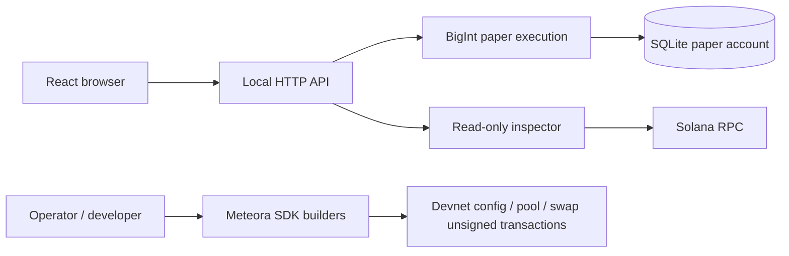

# Architecture and integration path



## Local execution

The server provides `/api/paper`, `/api/paper/create`, `/api/paper/quote`, `/api/paper/trade`, `/api/paper/reset` and `/api/inspect/:mint`. `GET /api/config` describes browser execution mode. Writes require JSON and reject cross-origin browser requests. It binds to `127.0.0.1` by default. This is one local paper account, not a multi-user service.

All trade amounts are integer strings. SOL uses nine decimals and paper tokens use six. The quote carries a coin version; execution rejects outdated versions and any result below `minOut`. A SQLite `BEGIN IMMEDIATE` wraps state read, execution and commit. Failed operations roll back. Reset restores the fictional markets and a 10 SOL paper account.

At 84.95 SOL of paper reserves the simulation stops accepting curve trades. It does not invent a DAMM trade, liquidity migration or reward payment. Launch slot is approximated from wall-clock time at 400 ms per slot in the paper model; actual Solana slots must be read from RPC in the live path.

## Devnet transaction builders

`MeteoraBuilder` checks the cluster genesis hash before building transactions. Callers supply public account addresses; no operator private key is loaded. `createConfig`, `createPool`, `swap` and `exportUnsigned` build or encode transactions. They do not sign or send them.

Example: create an unsigned partner config transaction for a separately controlled devnet payer. Keep the **config signer** yourself; this example does not persist or expose its secret.

```ts
import { Connection, Keypair, PublicKey } from '@solana/web3.js';
import { MeteoraBuilder } from './server/meteora.js';

const builder = new MeteoraBuilder(new Connection('https://api.devnet.solana.com'));
const config = Keypair.generate();
const payer = new PublicKey('YOUR_DEVNET_WALLET_PUBLIC_KEY');
const tx = await builder.createConfig({
  payer,
  config: config.publicKey,
  feeClaimer: payer,
  leftoverReceiver: payer,
  quoteMint: new PublicKey('So11111111111111111111111111111111111111112'),
});
const unsigned = await builder.exportUnsigned(tx, payer);
// The application integrating this module must simulate, collect the config
// signer + payer signatures, send, and confirm using lastValidBlockHeight.
```

Creating a pool also needs a new mint signer and an already-created, verified partner config on the same cluster. Metadata `uri` must point to durably hosted JSON. Signatures from payer, config and mint must be collected as appropriate; unsigned base64 alone is not a complete launch. Blockhashes expire, so rebuild/requote after expiry rather than resending stale payloads.

For swaps, use the SDK's live state/quote methods with the current activation point and slippage, then pass a positive `minimumAmountOut`. Recheck pool state, expected program/config and wallet intent before signing. Once migrated, route to DAMM v2, not the DBC swap builder. The builder is intentionally not linked to the paper UI until that path is implemented and verified.

## Remaining product services

1. **Real launch/trade UI:** wallet-standard integration, durable metadata upload, live quotes, transaction simulation, signer collection, confirmation, idempotent retries and DBC/DAMM routing. Validate the first-buy exemption and every account against the selected partner config.
2. **Indexer:** consume finalized DBC/DAMM events, deduplicate signatures + instruction indexes, detect migration, rebuild from checkpoints and publish market data over WebSocket/SSE.
3. **Holder reward service:** snapshot eligible balances at explicit slots, exclude configured accounts, calculate integer allocations and residuals, persist per-epoch entitlements, claim creator fees and use an idempotent payout queue. The paper `holders` flag alone performs none of this.
4. **Buyback worker:** persist claimed-fee inputs and job IDs, get a live quote, enforce spending/slippage limits, simulate, sign with controlled infrastructure, confirm and reconcile. An interval timer alone is not a reliable or auditable implementation.
5. **Production backend:** authenticated per-wallet accounts, independent ledgers, rate limiting, request limits, CSRF controls, database migrations/backups, operator access controls and observability. Never expose the shared paper API as a production exchange.
6. **Additional features:** USDC/custom partner configs, recipient splits/charities, bounties, community feeds, streaming/media, fee claims and explicit automation labeling. Each needs its own data model and operational tests.

## Validation performed

- Strict TypeScript compilation and production Vite build.
- Integer parsing, launch-slot fees, exact fee conservation, buy/sell round trip, slippage, stale versions, invalid inputs, insufficient balances and graduation limits.
- SQLite failed-write rollback and persistence across reopen.
- SDK-generated policy against the decoded mainnet snapshot and rejection of a mainnet genesis hash by unsigned builders.
- Browser smoke checks are recorded in the accompanying verification notes after execution.

No devnet or mainnet transaction was signed, submitted or funded during this work. Tests of config geometry are not proof of successful end-to-end launch, migration or payout operation.
